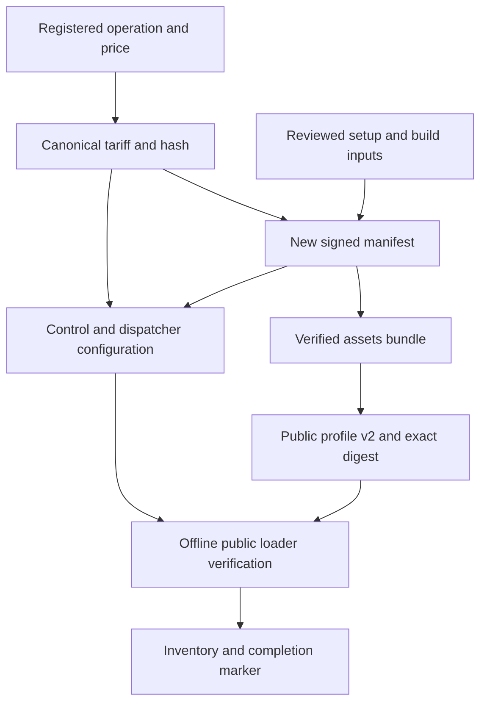

# General API onboarding design

Status: proposed implementation contract. This document defines the change;
it does not announce a release or a deployed capability.

## Purpose and supported outcome

An API provider or proxy operator must be able to describe a supported API once,
generate consistent registration and distribution inputs, and verify an API-only
installation in a fresh development environment. Consumers must be able to load
an authenticated public profile, discover the registered operations, and use the
existing SDK or clientd without configuring an inference model.

The first onboarding contract covers the existing synchronous, registered POST
JSON adapter: Bearer authentication upstream, bounded JSON input/output, and a
fixed charge for a complete valid HTTP 2xx JSON response. OpenRouter and other
inference adapters are additional use cases of the same payment system.

This change includes:

- Public profile schema 2, API-aware preflight, and API-only/mixed proxy profiles.
- Offline registration and new-deployment preparation, with computed tariffs,
  manifest bindings, public assets, and complete private service configuration.
- General API installation and invocation through the existing native client.
- A reproducible local onboarding demonstration using a synthetic lookup API,
  installed SDK/native artifacts, real proofs, and actual local Vault SBF execution.
- A source-based new-Devnet operator procedure for the generated configuration.

GET/query templates, other authentication schemes, streaming, binary bodies,
asynchronous jobs, different billing rules, generic Direct access, session reuse
optimization, hosted onboarding, and production/mainnet are outside this change.
Unsupported contracts must fail with a specific configuration error. They must
not be silently rewritten as POST JSON or inference requests.

An upstream provider that already fits this contract needs no ZK implementation
for proxy access. The operator uses its ordinary provider credential and applies
ZKAPI authorization and billing at the proxy. A provider operating its own proxy
uses the same operator configuration and infrastructure.

## Existing implementation and integration gaps

The implementation must build on these source paths, rather than introduce a
second client or payment implementation:

| Source | Existing behavior | Required change |
|---|---|---|
| [SDK control](../../packages/sdk/src/control.ts) | `ApiBinding`, `ApiTariff`, `ApiService`, exact quotes and shared authorization | Reuse validators; expose shared nonfinancial configuration validation where necessary |
| [SDK client](../../packages/sdk/src/client.ts) | `services`, `listApis()`, `requestApi()` and the existing wallet | Reuse; make configuration validation callable before native custody initialization |
| [ClientDaemon](../../packages/sdk/src/clientd-bridge.ts) | Generic calls use shared dispatch and one request per session | Preserve settlement, journal and no-replay behavior |
| [Public profiles](../../packages/sdk/src/public-profile.ts) | Schema 1, nonempty models, model-only tariff checks | Add schema 2, service pins/options and API catalog matching |
| [Control catalog](../../services/control/src/api.rs) | Emits `models` and optional `apis` | Retain wire shape; test both empty and populated API catalogs |
| [Generic adapter](../../services/control/src/generic.rs) | Registered POST JSON, fixed Bearer header, bounded responses | Retain the adapter contract |
| [Control configuration](../../services/control/src/config.rs) | Passes the control `local_test_only` flag to generic origin validation even with a Devnet overlay | Derive a separate validated provider transport policy so public HTTPS registration can start |
| [Initial staging](../../scripts/prepare_public_devnet_deployment.ts) | One direct OpenRouter consumer and tariff | Add versioned normalized consumer inputs and initial API registration |
| [Manifest base](../../scripts/i10_public_devnet_profile.ts) | Static inference endpoint list | Derive endpoints for new staging from the selected capabilities |
| [Native input installer](../../tools/public-devnet-consumer/native-inputs.mjs) | Copies model tariffs; proxy egress permits `/v1` | Copy service tariffs and permit registered proxy operation paths |
| [Native profile CLI](../../apps/clientd/cmd/clientd/profile.go) | Model-oriented setup and request commands | Validate service paths; add API discovery and explicit API invocation |
| [Native runtime](../../apps/clientd/runtime.ts) | Supports services but initializes custody before some configuration checks | Complete nonfinancial validation before initial custody creation |
| [Local runner](../../scripts/run_general_api.py) | Requires prior I08/I09 files under `target/` | Generate its own pinned test prerequisites in the new run directory |
| [Existing lifecycle test](../../packages/sdk/test/general-api-e2e.ts) | Constructs source-level clients/configuration directly | Keep as financial regression; add onboarding through generated configuration and installed exports |

In particular, the current public preflight rejects an `apis` catalog member even
though control emits it. Adding `services` to the profile alone does not fix this
or the native installer's missing proxy route.

## Financial and compatibility invariants

`ControlClient`, `WalletClient`, `ClientDaemon`, `EncryptedJournal`, the ledger,
the independent signer, and persistent dispatcher claims remain authoritative.
No circuit, proof public input, Vault layout, database migration, journal schema,
authorization version, receipt format, or custody migration is required.

Preserve exact accepted authorization and receipt bytes. Preserve the existing
`inference_api_origin` manifest field as the execution origin for both kinds of
API. A field rename is not part of this change. Unknown execution never causes
an automatic retry. An HTTP response does not replace verified settlement.

API registration applies only to new staging. It must not edit an active Pool's
manifest, append tariffs to an existing funded installation, reset a database,
initialize an existing journal, or republish an immutable release. The initial
release of the tool has no in-place registration/update command.

Registration, validation, staging and preflight perform no provider calls,
transactions, funding, service installation or service restarts. Local demo
execution is a separate explicit command using generated synthetic state.

## Public profile schema 2

### Wire types

Keep the existing schema 1 type and validation behavior. Export a discriminated
union named `PublicDeploymentProfile` and explicit `PublicDeploymentProfileV1`
and `PublicDeploymentProfileV2` types. Schema 2 has the existing required fields
plus required `services`. It has the same optional fields as schema 1.

```ts
type PublicDeploymentProfileV2 = {
  schema: 2;
  id: string;
  revision: number;
  sdkVersions: readonly string[];
  protocolLayoutVersion: 2;
  bundle: { url: string; sha256: string };
  rpcUrl: string;
  indexerOrigin: string;
  mode: Mode;
  models: readonly ModelConfiguration[];
  modelCapabilities: Readonly<Record<string, {
    streaming: boolean;
    tools: boolean;
  }>>;
  services: readonly ApiService[];
  directProviderBases?: CreateClientOptions['directProviderBases'];
  oaVerifier?: CreateClientOptions['oaVerifier'];
  preparationCommitment?: 'confirmed' | 'finalized';
};
// ApiService remains exactly { tariff: ApiTariff }.
```

An API-only selection is `mode: "proxy"`, `models: []`,
`modelCapabilities: {}`, and one or more services. A mixed proxy selection has
both models and services. A Direct selection must have `services: []` and at
least one model; existing independent provider/verifier pins remain mandatory.

Do not add another service descriptor, endpoint string, authentication object,
or capabilities object to a service entry. Its authenticated tariff already
contains the complete operation descriptor. Derive the client endpoint with
`apiOperationPath()`.

### Validation rules

- Exact closed object schemas; reject unknown fields, duplicate JSON keys,
  explicit null substitutes, and invalid UTF-8 using the current strict parser.
- Schema 1 retains nonempty `models` and forbids `services`.
- Schema 2 permits 0–32 models and 0–64 services, with at least one combined entry.
- `modelCapabilities` contains exactly the model IDs, including `{}` for API-only.
- Model validation retains the existing provider/mode/API/tariff rules. Do not
  invoke the nonempty-model validator on an API-only selection.
- Service identities `(service, operation)` are unique. Run the shared
  `validateApiService()` and descriptor validation for every service.
- Service tariff hash is lowercase SHA-256 of JCS tariff bytes excluding
  `tariff_hash`; it must be listed in the authenticated manifest.
- Require canonical integer validity times and `valid_until > valid_from`.
  Loading authenticates historical inputs without rejecting them solely for
  expiration. Preflight/admission require `valid_from <= now < valid_until`.
- The service's upstream origin must satisfy the public profile's existing
  public HTTPS origin policy as well as the adapter descriptor contract.
- Verify `nano_usdc_numerator <= manifest.cap_micro_usdc * 1000` using `bigint`.
  A profile must not advertise an operation that cannot fit the authorization cap.
- Preserve the existing 1-MiB profile download bound, bundle limits, explicit
  mode, exact SDK-version membership, trust verification and abort behavior.

Refactor shared pure selection validation into a nonfinancial helper used by
the client factory, public loader, registration compiler and native runtime.
Keep environment-specific public URL validation at the public boundary. Do not
put filesystem access or Node-only dependencies into browser SDK entry points.

`clientParts()` returns cloned `services` as well as models. `validateModelPins()`
becomes a selection-pin check that handles both tariff types. Preserve the
existing `models` error component; add `services` for service contract/pin errors.
The downloaded profile is deeply frozen; returned service/tariff objects are
detached copies. Mutating caller options must not change authenticated state.

### Versions and custody

Read schema 1 without rewriting its bytes, digest, or displayed schema. Internal
normalization to `services: []` is transient only. `PUBLIC_PROFILE_SCHEMA` denotes
the newest authored schema, 2; a separate supported-schema set drives reading.

Keep `sdkVersions` as an exact membership check against the SDK build version.
Supporting the schema 1 parser does not make every old immutable profile valid
for a new SDK version. Do not add version aliases or treat an existing `.8`
profile as advertising an unreleased runtime. Derive the SDK version constant
from the package version at build time, with a consistency test.

Before authoring or packaging any schema 2 profile, assign the source build a
distinct unpublished development version. Require the same exact value in
package metadata, lock metadata, generated version constant and profile. The
schema 2 author rejects the published `0.2.0-devnet.8` identifier. Selecting the
eventual public release version remains a separate distribution decision; local
development versioning must not imply that those artifacts have been released.

Existing funded users retain their original SDK/native runtime, profile digest,
bundle and recovery inputs. New profiles use the actual compatible build version
and a new installation/namespace. `installedProfileSha256` must still reject a
different proposed digest before fetching anything.

## Catalog and read-only preflight

Continue using `GET /zkapi/v1/catalog`; do not add a second discovery protocol.
The accepted closed top-level shape is `{models, apis?}`. Normalize absent `apis`
to an empty array. Require arrays and at most 256 entries in each. Validate all
entries, including entries not selected by the profile.

| Entry | Exact fields and requirements |
|---|---|
| Model | `model`, `provider`, `modes`, `endpoints`, `modalities`, `tariff_hash`; validate enum combinations, scalar types and duplicate-free arrays. Direct entries may retain the currently empty endpoint list. |
| API | `api`, `mode`, `provider`, `endpoint`, `tariff_hash`; `mode` is `proxy`, provider is `generic`, descriptor is valid, and endpoint equals `apiOperationPath(api)`. |

Reject duplicate model/provider/mode/tariff identities and duplicate
service/operation/tariff identities, including conflicting descriptors with the
same identity. The tariff hash is part of the identity so it does not conflate
different prices. This does not change the runtime prohibition on overlapping
tariff validity windows for one operation; historical tariffs remain retained
for settlement, and only currently valid tariffs are advertised. Do not require
the catalog and profile to have identical total membership.

For each selected model, retain exact provider, tariff, mode and required endpoint
matching. For each selected service, require the complete descriptor to match by
JCS bytes, in addition to tariff hash, endpoint, provider and mode. Valid additional
catalog entries are observable but never added to the client's selection.
API-only preflight fails if its selected service is absent, including an omitted
`apis` array. An inference-only profile can pass with an omitted/empty `apis`.

Add this field to `PublicPreflightResult`:

```ts
apis: readonly {
  service: string;
  operation: string;
  endpoint: string;
  tariffHash: string;
}[];
```

Keep `models` (empty for API-only), existing chain checks, and
`operatorAdmission: "unverified"`. Retain the current GET and finalized RPC
allowlist. Preflight must not request a quote, generate a proof, create custody,
authorize a session, probe an upstream, or execute a registered operation.
Catalog agreement is not evidence of provider credit or successful execution.

The existing public OpenRouter gateway and its readiness projection remain
reference-deployment components. A new generic operator exposes the generated
control/proxy routes through its own reviewed frontend; the registration tool
does not route it through that OpenRouter-specific gateway.

## Offline registration compiler and CLI

### Implementation boundary

Add `scripts/api_registration.ts` for pure input validation, tariff generation,
selection normalization and expected output bindings. Add `scripts/zkapi_api.ts`
as the filesystem/CLI adapter. Both use SDK JCS, descriptor, selection and tariff
validation; do not copy pricing arithmetic into a new library or Go code.

Keep the tool source-distributed in this change. It runs with the pinned Node
from the repository. Native consumers continue to use the packaged installer;
an operator binary/package installer is not required for this scope.

### Registration input

The CLI consumes one owner-private project file. It references an independently
hashed new-staging configuration and a private operator configuration. Services
are declared once in the project file:

```ts
type ApiProject = {
  schema: 1;
  target: 'devnet-new';
  staging: { path: string; sha256: string };
  operator: { path: string; sha256: string };
  services: readonly {
    api: ApiBinding;
    priceMicroUsdc: string;
    validFrom: string;
    validUntil: string;
    credentialFile: string;
  }[];
};
```

An example service entry, before real host/credential/validity values are filled:

```json
{
  "api": {
    "version": "1",
    "service": "weather",
    "operation": "lookup",
    "method": "POST",
    "origin": "https://weather.example",
    "path": "/v1/current",
    "request_max_bytes": "4096",
    "response_max_bytes": "65536",
    "timeout_seconds": "30",
    "billing": "http_2xx_json"
  },
  "priceMicroUsdc": "250",
  "validFrom": "1791673200",
  "validUntil": "1794265200",
  "credentialFile": "/absolute/private/weather-api-key"
}
```

`priceMicroUsdc` is a positive canonical integer string; never accept a floating
point JSON number. The friendly compiler uses whole micro-USDC per call because
each generic session settles one call. Compute `nano_usdc_numerator` as
`BigInt(priceMicroUsdc) * 1000n`, check the signed i64 maximum and Pool cap, and
emit the decimal string. The underlying protocol still supports nano-USDC rates;
this initial registration interface deliberately has one unambiguous price unit.

Generate the existing tariff exactly: `version:"2"`, `provider:"generic"`,
`pricing_basis:"fixed_request"`, the full `api`, the explicit validity window,
one `requests` rate with denominator `"1"`, and fee `"0"`. Compute its hash with
the existing JCS implementation. The same immutable tariff object feeds the
profile, control and local client configuration.

`credentialFile` is a canonical absolute path. Do not read its contents during
registration, signing or inventory verification. A destination-host credential
may not exist on the staging machine. The dispatcher performs the existing
owner/mode/content checks at startup. No secret value, private path or provider
credential is copied into public outputs.

The compiler rejects duplicate operations, unsupported fields/contracts,
invalid origin/path, fractional/out-of-range numbers, invalid intervals, and
prices above the cap. Validity validation is deterministic; no current time is
inserted into signed outputs. Preflight reports expired/not-yet-valid selection.

### Command contract

```sh
node scripts/zkapi_api.ts init --output /absolute/new-api-project.json
node scripts/zkapi_api.ts validate --config /absolute/private/api-project.json
node scripts/zkapi_api.ts prepare --config /absolute/private/api-project.json \
  --output /absolute/new-staging-directory
node scripts/zkapi_api.ts verify --directory /absolute/staging-directory \
  --inventory-sha256 INDEPENDENTLY_REVIEWED_SHA256
```

- `init` creates an exclusive owner-private template with the existing adapter
  constants and example limits. Unset pins, paths, price and dates are explicit
  placeholders; `validate` rejects them. It creates no credential or wallet.
- `validate` reads strict JSON and pinned public setup/build/artifact inputs,
  checks all cross-file bindings and reports the normalized selection. It does
  not read signing/provider secrets, sign anything or create outputs.
- `prepare` performs validation, then invokes the initial staging builder and
  private configuration renderer. It reads only the explicitly supplied manifest
  signing key when signing is required. It sends no network request.
- `verify` authenticates the inventory using the supplied digest, verifies each
  file's exact size/hash, and re-runs public/private cross-binding checks. It
  does not require signing keys or provider credential contents.

Successful commands produce bounded JSON: operation identities, counts, public
artifact hashes, completion state and zero action counters. Do not print private
configuration objects or upstream error text. Input/output flags can name private
files, but secret values are never command arguments.

Use stable error codes: `invalid_schema`, `unsupported_api_contract`,
`duplicate_operation`, `invalid_tariff`, `price_exceeds_cap`, `pin_mismatch`,
`authority_mismatch`, `provider_config_mismatch`, `staging_provenance_required`,
`output_exists`, `unsafe_path`, `incomplete_output`, and
`artifact_verification_failed`. A diagnostic may include a schema field path and
a fixed reason. Exit 0 on success, 2 on invalid input/configuration and 1 on
I/O/build-artifact/verification failure. No raw exceptions or private values.

There is no `--force`, in-place update, automatic deployment, funding, publishing,
live API test or package/host installation subcommand.

## New staging and operator configuration

### Versioned staging input

Add schema 2 alternatives for `InitialPublicStagingPreparation` and
`PublicDeploymentPreparation` in the existing staging module. Retain schema 1
and its OpenRouter behavior. Schema 2 reuses all existing setup, build, authority,
notice, origin and provenance inputs, replacing `consumer` with:

```ts
type StagingConsumer = {
  id: string;
  revision: number;
  mode: Mode;
  models: readonly ModelConfiguration[];
  modelCapabilities: Readonly<Record<string, {
    streaming: boolean;
    tools: boolean;
  }>>;
  services: readonly ApiService[];
  directProviderBases?: CreateClientOptions['directProviderBases'];
  oaVerifier?: CreateClientOptions['oaVerifier'];
};
```

For schema 2, remove `privateRpcUrl`, `indexerListen`, `snapshotsDirectory` and
`startSlot` from the staging input. They belong exclusively to
`OperatorPreparation.indexer`. The public-only staging builder does not emit an
indexer configuration; the operator renderer does. Reject these removed fields
in schema 2 rather than accepting conflicting copies. Schema 1 retains its
existing fields and output behavior.

The project-referenced staging template has `consumer.services: []`; the
registration compiler installs its generated services in memory before calling
the builder. Reject pre-populated services in this template to avoid conflicting
sources. The general API command requires `consumer.mode:"proxy"`. Models may
be empty or contain validated existing inference configurations.

The initial builder computes the sorted unique union of all selected tariff
hashes before signing the new manifest. Derive `api_endpoints` from the existing
common control routes, selected inference routes (and `/v1/models` when needed),
and concrete registered operation paths. Keep existing recovery/withdrawal
routes and their interpretation; do not introduce wildcard forwarding.

The later origin-preparation function still requires every selected tariff to
be already pinned by its source manifest. It must never append tariffs. Both
builders retain exclusive new outputs, artifact/notice validation and their
existing staging-provenance checks.

Only undeployed state, or independently verified program-deployed/Pool-not-yet-
initialized state, is accepted. An offline declaration is not proof that a live
Pool is unused. Chain verification and later transaction execution remain
separate operations in the operator procedure.

### Operator input and rendering

The owner-private operator file has this closed schema. `PinnedFile` means
`{path:string, sha256:string}`. All paths are canonical absolute paths. Numeric
slots/poll intervals are safe nonnegative JSON integers within the corresponding
Rust bounds; financial priority-fee units retain the existing Rust contract.

```ts
type OperatorPreparation = {
  schema: 1;
  targetRoot: string;
  inspectionBinary: PinnedFile;
  control: {
    listen: string;
    primaryRpc: string;
    secondaryRpc: string;
    indexerOrigin: string;
    quoteSeedFile: string;
    receiptSeedFile: string;
  };
  dispatcher: {
    binary: PinnedFile;
    databaseUrl: string;
    claimsDirectory: string;
  };
  indexer: {
    rpcUrl: string;
    startSlot: number;
    listen: string;
    publicOrigin: string;
    snapshotsDirectory: string;
  };
  signer: {
    journal: string;
    socket: string;
    stateSeedFile: string;
    clearanceSeedFile: string;
  };
  database: {
    migrationDsnFile: string;
    writerDsnFile: string;
    signerDsnFile: string;
  };
  challenger: {
    rpcUrl: string;
    databaseDsnFile: string;
    journalDirectory: string;
    node: string;
    transportBridge: PinnedFile;
    feeKeyFile: string;
    payer: string;
    pollSeconds: number;
    alertSinkDirectory?: string;
    priorityFee?: PriorityFeePolicy;
    archiveBatch?: ArchiveBatchPolicy;
  };
  inferenceProviders: readonly ProxyProviderConfig[];
};
```

`PriorityFeePolicy`, `ArchiveBatchPolicy` and `ProxyProviderConfig` have the exact
field names and bounds of the existing Rust wire types (including their nested
snake_case fields). Add schema/serialization tests against those types. The
renderer maps only the explicitly listed outer camelCase names. Inference
providers are empty for API-only and cover the selected models exactly for mixed
proxy. Do not accept arbitrary JSON merge patches or execute the existing
OpenRouter/host-specific bootstrap script.

The dispatcher already requires an embedded database connection string, so
`dispatcher.databaseUrl` is explicitly private and is copied only into private
dispatcher output. This design does not add a second dispatcher DSN-file ABI.
Other DSN files remain references: startup reads them into the existing migration,
control and signer environment variables, and challenger retains its existing
`database_dsn_file` input. Staging does not read those files or create roles.

`targetRoot` is the final installation location of the generated tree. All
generated artifact/config paths are `targetRoot` plus their inventoried relative
path. Separate state, credential, binary and database references are explicit
destination-host paths. The output can be prepared elsewhere and copied intact
to that exact root; relocation to another root requires new preparation, never
ad hoc edits. The public release URLs remain independently explicit.

Offline verification resolves generated public artifact paths through a strict
`targetRoot -> outputDirectory` mapping, using only inventoried relative files.
It does not open destination-host secret/state paths. `inspectionBinary` is a
locally installed hash-verified `controld` used for offline inspection; destination
dispatcher/Node/bridge binaries are verified on the destination at startup.
The same policy supports preparing directly at the intended target root.

The renderer supplies manifest, trusted manifest hash, tariffs, API descriptors,
Pool identity and `DevnetConfig` from staged outputs, never from duplicated user
values. It emits complete `control.json`, `dispatcher.json`, `indexer.json`,
`challenger.json`, `signer.json`, and signer input/start metadata. A missing prerequisite is an
error, not a configuration file containing unresolved placeholders.

Control uses the pinned dispatcher process. Dispatcher gets the exact same API
descriptors and credential references, with no nested dispatcher. Preserve the
existing flag semantics: public Devnet control remains `local_test_only:true`
with explicit `devnet`; public provider dispatcher uses `local_test_only:false`
with its explicit Devnet scope. Local fixtures use the existing local settings.
Enable no synthetic inference adapter for an API-only public configuration.

Fix the existing provider-policy coupling explicitly. After authenticating the
Devnet configuration, derive an internal `ProviderTransportPolicy`:
`LocalFixture` for no Devnet overlay, or `PublicDevnet` for a validated overlay
with the isolated dispatcher. Pass it to provider configuration validation and
runtime construction. Generic `LocalFixture` accepts only numeric loopback HTTP;
`PublicDevnet` requires HTTPS and the existing public-address/DNS-pinning checks
in dispatch. A bare flag or unauthenticated manifest cannot select it. Reject a
public generic provider without its required validated dispatcher scope.
Dispatcher independently validates the same scope from its own configuration.
Do not flip control's test-only flag or relax generic destination checks.

Split `RuntimeConfig::validate_public_inputs()` from startup validation. The pure
part verifies manifest/setup/build/capability inputs and derives `BindingConfig`
and `SignerConfig` using the manifest's public quote/receipt keys. It does not
read service seeds, provider credentials, database state or destination-host
runtime directories. `validate()` calls this part and then retains all existing
private-key correspondence, socket/credential/binary and database-policy checks.

Add `controld inspect-config CONFIG --input-root LOCAL --target-root FINAL` before
the current database-environment lookup. It uses the limited public artifact
resolver above, runs public validation, and outputs
`{schema:1, manifestHash, tariffHashes, operations, signer}`. It performs no DNS,
RPC, database connection, proof, signing or provider call. The CLI verifies the
inspection binary pin and uses its actual `signer` output as `private/signer.json`.
The embedded public-profile path in that output retains its destination form.
Keep `signer-config`, `provision` and `serve` startup validation behavior intact.

Emit `private/startup.json` with config paths and explicit private DSN/key/state
references. It records this order: migrate a new database; provision the Pool
with admission disabled; initialize the new signer journal and challenger once;
start signer and indexer; after reconciliation start control and challenger.
Runtime state/roles and these actions remain part of the operator startup guide,
not side effects of preparation. Deployment and finalized initialization-slot
verification precede startup. Schema 2 indexer start slot is also the generated
challenger start slot, eliminating a duplicate user-supplied value.

Render a non-executable route description for the operator's HTTPS frontend:
control `/zkapi/v1` routes, exact generic POST paths on the execution origin,
selected inference routes, all five indexer routes below and restricted RPC.
Serve these GET routes on the profile's `indexerOrigin`, forwarding to the
generated indexer listener:

| Route | Required use |
|---|---|
| `/zkapi/v1/tree/root` | Deposit note selection and finalized wallet state |
| `/zkapi/v1/tree/notes/{id}/path` | Active-note paths for wallet operations |
| `/zkapi/v1/tree/notes/{id}/zero-path` | Next-deposit and pending-note paths |
| `/zkapi/v1/tree/snapshot` | Snapshot metadata for preflight and authorization |
| `/zkapi/v1/tree/snapshots/{name}` | Content-addressed snapshot download |

Retain the indexer's existing parameter validation and response bounds. These
are indexer routes, not control routes. When origins are shared, they must take
precedence over the control `/zkapi/v1` mapping; unrelated paths and methods
must not gain indexer access. Do not infer wallet route coverage from preflight,
which intentionally reads only the snapshot routes.

Test the generated route description with a fixture frontend that consumes it
without hand edits. Route preflight and SDK/native deposit and withdrawal
traffic through that frontend, including separate and shared service origins.
Assert that every required indexer route selects the indexer backend, and reject
a description with any of the five routes omitted or assigned to control.
Include request/response limits, maximum upstream deadline, body preservation,
`Idempotency-Key` preservation and disabled mutation retries. TLS, CORS and the
frontend itself remain operator-provided; no CloudFront or host-specific default.

### Output integrity and publication boundary

```text
new-staging/
  public/
    profile.json
    assets/                 # existing bundle format, proofs, WASM, notices
  private/
    control.json
    dispatcher.json
    indexer.json
    challenger.json
    signer.json
    signer-inputs.json
    startup.json
    frontend-routes.json
  provenance/               # builder's reviewed public inputs and declarations
  inventory.json
  preparation-report.json
  complete.json
```

Only `public/` is publishable. Keep the containing directory and private files
owner-only. The private inventory lists relative paths, byte lengths, hashes and
public/private classifications, including input hashes and the registration
contract version. The inventory excludes itself and `complete.json`. It never
stores secret file contents. `complete.json` is exactly
`{schema:1, inventorySha256:string}` and is written last, exclusively, after
round-trip checks.
The completion marker is not a trust anchor; `verify` still requires an
independently supplied inventory digest.

Validate canonical paths, reject symlinked output ancestors/entries and refuse
existing output before reading signing material. Use exclusive creation for all
files. Preserve failed partial output for inspection, without a completion marker.
Rerunning `prepare` against it fails; a new output directory is required.
Verification requires the actual file set to equal inventory entries plus
`inventory.json` and `complete.json`; it rejects extra files and
traversal/case-collision paths.
Failed verification never repairs or rewrites signed artifacts.

Public bytes are deterministic for identical explicit inputs, including tariff
validity, release URL, profile ID/revision, setup/build artifacts and signing key.
Timestamps may appear only in the private preparation report. The report records
`networkActions:0`, `providerActions:0`, `transactionActions:0`, `serviceActions:0`
and `chainCompatible:false`. Finish the report before hashing the inventory,
then write the inventory and completion marker. Later live evidence goes into a
separate report; never rewrite this inventoried preparation report.

The round trip is:



Use the real public loader with an injected, exact URL-to-file fetch during the
offline round trip. It must have no network fallback. A profile downloaded from
an endpoint is authenticated by an independently installed digest, not by a
checksum downloaded from the same untrusted endpoint.

## Native installation and request interface

Extend the existing `install-native` command and `installNativeInputs()` rather
than adding a second profile downloader in Go.

- Materialize service tariffs as generated `api-tariff-N.json` filenames; never
  use untrusted service IDs as filesystem paths. Emit absolute
  `runtime.services:[{tariff: path}]`, retaining `models:[]` for API-only.
- Reuse the existing authenticated artifact and notice copies and installation
  receipt. Include the generated service tariff files in integrity verification.
- For proxy mode, allow inference `/v1` egress only when models are selected and
  add each registered operation path on `manifest.inference_api_origin` when
  services are selected. Control and execution origins may differ.
- Never add a service's upstream origin to consumer egress. The dispatcher holds
  that route and credential. Retain Tor behavior and no direct fallback.
- Prefix route matching remains transport policy; exact operation authorization
  is still enforced by the SDK/control descriptor. Test that unrelated paths
  cannot become authorized through a prefix match.
- An API-only `model-availability` request fails as `unsupported_for_profile`
  before contacting OpenRouter. Discovery comes from the verified profile and
  existing catalog/local API-list routes.

`clientd setup` validates service entries, paths and selection before creating
the new profile directory. Native runtime validates manifest/artifacts/tariffs
before `initializeJournalKey`. Share TS contract validation with the SDK rather
than building another Go pricing validator. Go validates the service container
and canonical absolute paths; a read-only pinned Node validation mode performs
the full configuration check. This mode does not receive wallet/password/token
inputs, generate proofs, initialize storage or access a provider.

The installed validation command is:

```sh
/absolute/install/bin/node /absolute/install/apps/clientd/runtime.ts \
  --validate-config \
  --distribution /absolute/install/release.json \
  --distribution-sha256 INDEPENDENTLY_REVIEWED_DISTRIBUTION_SHA256 \
  --runtime-config /absolute/deployment-inputs/runtime.json \
  --runtime-sha256 INDEPENDENTLY_REVIEWED_RUNTIME_SHA256
```

Require each flag exactly once, canonical absolute paths and lowercase SHA-256
pins; reject unknown flags and the ordinary runtime's socket arguments in this
mode. `clientd setup` verifies the distribution before executing its Node/runtime
files and invokes this command with stdin closed. The validator branches before
secret-input handling, verifies the distribution and exact runtime bytes, then
validates the nonfinancial configuration using the shared TS helpers. Resolve
prover/verifier paths and hashes from the verified distribution in memory before
validation; reject conflicting supplied pins. Deployment inputs may omit
`journal`, `custody` and `note_id`. Do not create or read financial storage,
execute proof binaries, open sockets, or perform DNS/RPC/HTTP calls. Finalized
chain checks remain required at normal runtime startup.

Exit 0 writes exactly one JSON object plus newline to stdout, bounded to 64 KiB,
with empty stderr:

```ts
type NativeConfigurationValidation = {
  schema: 1;
  valid: true;
  manifestHash: string;
  mode: Mode;
  models: readonly string[];
  operations: readonly {
    service: string;
    operation: string;
    endpoint: string;
    tariffHash: string;
  }[];
  custodyInitialized: false;
  networkActions: 0;
};
```

Sort model IDs and operation `(service, operation)` pairs by ASCII for this
summary only; preserve signed input bytes. Failure leaves stdout empty and
writes bounded `{schema:1,error:{code,field?}}` JSON to stderr, using the stable
registration error codes above and a schema field name only, never private
paths, values or raw exceptions. Exit 2 denotes invalid arguments/configuration;
exit 1 denotes I/O or artifact/pin verification failure. Setup requires exit 0
and the exact success schema before creating its profile directory, tokens or
note ID. A malformed/truncated result or process failure creates no destination;
existing or partial profile directories remain untouched. Test this ABI with
API-only, mixed and legacy inference inputs, missing or substituted artifacts,
invalid tariffs and secret canaries. Normal startup
reuses the same validation before `initializeJournalKey`; this offline result
does not replace startup checks or establish deployment availability.

Preserve `inference-token` filenames and the runtime `inference_token` ABI; user
documentation can call this the API token. Management credentials remain separate.
Keep the existing setup `base_url` for compatibility and add
`api_base_url:"http://<listen>/zkapi/v1"`. Skip OpenClaw files on API-only setup;
retain existing behavior for inference profiles.

Add these commands:

```sh
clientd request /absolute/profile apis
clientd api /absolute/profile --service weather --operation lookup \
  --operation-id UUIDV4 < request.json
```

`apis` uses the API token for `GET /zkapi/v1/apis`. `api` requires explicit
service/operation and UUIDv4, reads bounded JSON from stdin, and sends exactly
one POST with `Idempotency-Key`. Validate identity, body size and syntax before
dispatch. The command does not invent a new ID after an error and does not retry,
redirect or use environment proxies. Reuse the native HTTP request helper with
its no-retry behavior. The new API command has a 900,000-ms overall deadline;
API discovery has a 30,000-ms deadline. Its response bound is the selected
descriptor bound for success and the existing bounded error envelope for failure.
The outer deadline includes proof/authorization and body consumption, and may
expire on a slow preparation; expiry invokes existing uncertainty/recovery rules.

The current helper's 300-second timeout cannot be reused unchanged. For a saved
generic operation only, set SDK `sendOperation()` transport timeout to 660,000 ms
and route-matched native relay timeout/header timeout to 660,000 ms. Carry this
selection from the frozen saved quote, not a user header. Keep dispatcher IPC's
610-second limit and the descriptor's maximum 600-second upstream execution
limit; the extra transport time allows bounded IPC/network overhead. Keep
inference and unrelated RPC/control timeout values unchanged. The overall native
900-second deadline leaves up to 240 seconds for preparation/response handling
when the execution transport uses its full allowance; it is not a promise that
all preparations finish. No stage introduces a retry or a new settlement policy.
Use fake clocks/injected short budgets to verify ordering and cancellation,
including a 600-second descriptor, without a ten-minute test sleep.

Write only the API response to stdout. Write bounded operation ID, HTTP status
and recovery guidance to stderr; never token values or a dumped request. Non-2xx
or transport failure returns nonzero. Transport loss is an uncertain result;
the user inspects `status` and invokes existing recovery. A 2xx result alone is
not a claim that signed settlement has completed. Existing wallet, close,
recovery and withdrawal commands remain the way to manage the same note.

## Fresh local onboarding and evidence scope

### Two explicit verification paths

Do not add `allowLocal` to the public profile loader or allow a profile to select
weaker trust checks. It remains public-HTTPS/Devnet-only. Local financial fixtures
use a local manifest and must not pretend to be public Devnet.

1. **Public-format contract path:** API-only/mixed schema 2 profile generation,
   exact bundle/manifest/artifact validation, preflight and native materialization
   run against injected HTTPS/Devnet fixture responses. Assert all network calls
   are fixture reads. No actual Devnet execution is claimed.
2. **Local execution path:** the same registration compiler and private config
   renderer generate an explicitly local fixture installation; installed SDK and
   native clients execute it with real proofs, signatures, ledger and Vault SBF.
   Its provider HTTP, RPC envelopes and finalized observations are synthetic.

Both paths consume the same service/price declaration and are required. They are
not described as one public-loader-to-public-chain end-to-end test.

### Local command and inputs

Extend the runner with a stable interface:

```sh
python3 scripts/run_general_api.py --check-tools
python3 scripts/run_general_api.py --onboarding
```

`--check-tools` is read-only and lists all missing/mismatched requirements at
once. `--onboarding` creates a fresh run directory and builds/executes the local
demonstration. The existing no-argument financial regression remains available
but also uses the new independent prerequisite builder.

The runner uses a narrow test-only registration entry point, passed explicit
loopback addresses, fresh test credential paths and authenticated local fixture
pins. This entry point calls the same compiler/renderer with a separate local
origin policy; the production `ApiProject.target` accepts only `devnet-new`.
Local setup outputs `local-inputs.json` and local native inputs, not a misleading
public profile. Its test-only closed shape is:

```ts
type LocalFixtureInputs = {
  schema: 1;
  kind: 'local_fixture';
  bundle: { url: string; sha256: string };
  manifestHash: string;
  rpcUrl: string;
  indexerOrigin: string;
  mode: 'proxy';
  models: [];
  services: readonly ApiService[];
};
```

Use existing `loadDeploymentAssets()` local transport support and verify the
independently supplied fixture bundle digest, `deployment_environment:"local"`,
manifest hash, tariff pins and exact compiled descriptors. Refactor the private
native materializer to accept validated `{assets, selection, rpcUrl,
indexerOrigin, network}`. The public installer constructs those values only via
`publicProfileClientOptions(loaded)`; the test adapter performs the explicit local
checks. Do not weaken the public loader's WeakMap provenance check or export a
public method accepting arbitrary objects as authenticated profiles. Fixture
native network uses explicit `mode:"direct"`, `allow_local_http:true` and numeric
loopback-only routes.

Test-only entry points reside in test/runner modules, are not public SDK exports,
and refuse non-loopback service/RPC/indexer origins. The demo starts its own
lookup fixture and never takes a real provider URL or existing custody path.
Providers using another supported API copy the documented registration template
and use the separate new-Devnet staging procedure.

### Independent prerequisites

The fresh path requires installed pinned Node 24.19.0, npm 11.9.0, Rust 1.90.0,
Go 1.25.0 for native acceptance, cargo-build-sbf 4.1.0/platform-tools v1.54,
the Rust WASM target, PostgreSQL tools, Python and GNU tar. Chromium is not a
prerequisite for native/API onboarding. Preserve existing tool-selection
environment variables. Do not install tools, change shell profiles, start a
system database service, or acquire live credentials automatically.

Document dependency fetch separately (`npm ci --ignore-scripts`, pinned
`cargo fetch --locked` for relevant manifests and Go module download). The
prepared dependency inventory covers root npm, native production npm, external
consumer npm, Go modules and each Cargo lockfile. Ordinary verification uses
locked/offline Cargo, npm `--offline`, and Go `GOPROXY=off` with prepared caches;
SBF platform-tools and the WASM target must already be installed. Add explicit
offline options to existing distribution/install helpers used by the runner;
they must not silently download dependencies. Missing caches produce actionable
preparation guidance, not an unrelated historical test requirement. CI may fetch
dependencies in a separately named setup step before offline acceptance.

Track an external-consumer `package.json` and lock fixture with the reviewed
SDK dependency graph and exact acceptance-only dependencies, including esbuild
and its platform optional packages. The root lock alone does not cover those
acceptance dependencies. Materialize the fixture in the temporary consumer by
replacing only the local SDK tarball reference, version and integrity with the
fresh artifact's values. Check that its SDK dependency declarations and runtime
dependency versions, resolved locations and integrity agree with the reviewed
source/root lock; graph changes require an explicit fixture update.
The dependency setup step may populate caches using `npm ci` from this
materialized lock. Acceptance uses
`npm ci --offline --ignore-scripts --no-audit --no-fund`, without resolving a new
graph, rewriting the lock or falling back online. Apply the same no-drift rule
to the native production lock. Record fixture, source and materialized lock
hashes, and test that dependency drift and missing cache entries fail clearly.

Add `crates/zkapi-tree-prover/examples/test_setup.rs`, an output-only producer for
the existing deterministic TEST ONLY tree proving key. Reuse the circuit/seed
logic from the challenger tests; verify the result against tracked
`tests/fixtures/layout2/profile.json`. Do not invoke the existing fixture writer
that replaces tracked files, generate a new trusted setup, or alter fixture pins.

Produce the pinned source archive with `scripts/build_i02_source.sh` into the run
directory and verify its recorded hash. Verify the upstream request/withdrawal
keys and tracked tree VK/constants/IDL. Build current control/signer/dispatcher,
native prover/verifier, WASM, SDK tarball, native distribution and Vault SBF.
Reject oversized-stack SBF diagnostics. Pass all resulting absolute artifact
paths explicitly to the fixture; eliminate I08/I09 path assumptions.

Each run uses `target/general-api-local/run-*/`, isolated PostgreSQL on a private
Unix socket, generated fixture keys, and fresh custody. Never delete earlier
runs. Preserve interrupted journals and dispatcher claims. Record source input
hashes at start and finish, and fail if source changes during verification.
No prior `target/` report or installed funded profile is an input.

### Required API-only lifecycle

The orchestration must exercise actual commands, not repair generated JSON by
hand in the test:

1. Start loopback provider/RPC/indexer fixtures and compile the registration.
2. Render complete local control/dispatcher/native configuration and verify it.
3. Provision a fresh test database and start real `controld`, separate `signerd`
   and `dispatcherd` using their configuration parsers. This tests CLI wiring in
   addition to the current in-process control fixture.
4. Install the SDK tarball into an external temporary consumer without source
   imports. Build a separate native installation and use `clientd setup`.
5. Run the pinned Node offline validator and inspect its normalized operation
   list. Assert no quote, AUTH, upstream execution, transaction or initialized
   custody was caused by configuration validation. This is not HTTP discovery.
6. Explicitly initialize fresh synthetic custody and run clientd. Before funding,
   verify authenticated `clientd request ... apis` and its token-role restrictions.
   Then deposit 5,000,000 micro-USDC through the actual local Vault SBF path.
7. Execute lookup success, observed HTTP failure and malformed JSON using stable
   distinct operation IDs. Charge 250 micro-USDC only for the successful lookup.
8. Exercise duplicate IDs and recover the malformed-result operation after a
   controlled interruption with the original journal. Settle through existing
   code; the upstream count must not increase. Use fixture barriers, not random
   delays, to make interruption timing reproducible.
9. Withdraw 4,999,750 micro-USDC. Verify signed receipts/successor and compare
   SDK, SQL and Vault balances: deposit equals withdrawal plus 250; Vault is zero.

Run SDK-facade and installed-native variants with independent notes/databases so
their expected totals remain unambiguous. The main variant's exact call counts
are `{success:1, http_error:1, invalid_json:1}` and charge is 250. A separate
lost-downstream-response/restart variant uses one successful upstream call whose
usage was persisted before response loss; it charges 250 and withdraws 4,999,750,
with zero repeated calls after restart. A separate upstream-timeout variant has
one uncertain call, zero final charge under the existing fenced waiver policy,
and withdraws 5,000,000. Fault injection must identify which boundary lost the
response; it must not infer billing from the consumer's HTTP failure alone.
Every variant verifies its own terminal settlement. Keep the existing mixed-history
regression separately: inference 1 plus generic 250, withdrawal 4,999,749.

## Verification matrix and completion criteria

| Area | Required cases | Evidence class |
|---|---|---|
| Profile | v1 inference, v2 API-only, v2 mixed, v2 inference, unsupported schema/version; 0/64/65 services; both empty; Direct plus API; unknown fields | SDK unit/contract |
| Profile trust | Hash changes, omitted manifest pin, descriptor substitution, invalid validity/cap, public loopback rejection, original installed digest preserved | SDK unit/contract |
| Catalog | Optional/empty/missing APIs, malformed and duplicate entries, full descriptor/price match, additional valid entries not auto-selected, separate control/execution origins | SDK plus control contract |
| Read-only behavior | Record every fetch; only documented GET/RPC reads; zero quote/AUTH/provider/wallet/storage actions | SDK contract |
| Mutation safety | Frozen profile and detached services/tariffs cannot alter loaded options | SDK unit |
| Registration | Exact micro-to-nano conversion, bounds, duplicate IDs, unknown method/auth, deterministic bytes, matching profile/control/dispatcher tariffs | Compiler unit and Rust wire cross-check |
| Staging | API-only/mixed/legacy OpenRouter; initial tariff/endpoint set; later origin preparation cannot add tariff; no network; existing provenance checks | Offline artifact integration |
| Runtime configuration | Public generic HTTPS passes validated Devnet/dispatcher scope; local numeric HTTP passes fixture scope; ambiguous/unauthenticated/SSRF targets fail; offline inspection reads no secrets/DB | Rust configuration integration |
| Frontend routes | All five indexer GET routes select indexer; shared-origin precedence; omitted/misrouted paths rejected; generated routes cover preflight and SDK/native deposit/withdrawal without manual edits | Generated-route contract and local fixture integration |
| Files/secrets | Existing/partial output, symlink/traversal/case collision, inventory tamper, unlisted files, secret canaries absent from public files/logs | Filesystem integration |
| Native inputs | Copied API tariffs, models empty, exact execution routes, no upstream routes, notices preserved, old v1 installation | Installer integration |
| Native CLI | Discovery token role, explicit stable UUID, one send, bounded body, 600-second descriptor timeout ordering, nonzero unknown outcome, API-only setup, pinned validation command/output/exit ABI, validation failure creates no profile or custody | Go/runtime integration |
| SDK distribution | Install tarball outside checkout, import public exports, load v2 fixture profile and invoke API-only client | Installed-package acceptance |
| Dependency reproducibility | Reviewed consumer fixture and native lock; only SDK artifact substitution; exact runtime pins; missing offline cache and dependency drift fail; no lock mutation or online fallback | Distribution/runner integration |
| Local lifecycle | Fresh artifact bootstrap; actual CLI config; real proofs/signatures/ledger/SBF; success/error/unknown/restart/no replay/conservation | Local synthetic-provider acceptance |
| Native lifecycle | Built installation, setup/run/discovery/API/recovery/withdrawal with original custody | Local installed-native acceptance |
| Legacy | Original inference signed bytes, journals, receipt versions, v1 profiles and Direct mode behavior | Existing regression suites |

Use the relevant current unit/type/build checks in [Testing](../testing.md).
Extend external SDK acceptance to include generic API and profile fixtures;
merely running TypeScript source tests is insufficient for distribution coverage.

Add an explicit `general-api-onboarding` CI job from a recursive fresh checkout.
It prepares pinned dependencies/tools and runs the fresh path without downloading
previous local reports or lifecycle outputs. Dependency caches are allowed;
generated financial test state is not a reusable cache. Require executed test
counts; skipped/ignored/zero-case suites do not satisfy acceptance. Keep fast
schema/compiler/installer tests in the ordinary pull-request gate.

Reports stay under ignored `target/`. Include tool versions, source/artifact
hashes, stage results, operation counts, settlement verification and conservation.
Use separate scope fields for public-format fixtures and local SBF execution;
record `live_provider_verified:false`, `public_rpc_verified:false`, and
`release_gates_passed:[]`. Upload only redacted CI diagnostics, never full custody,
database, seed or journal directories. Failure keeps local recovery evidence.

Implementation is complete when a fresh checkout with documented installed tools
and fetched dependencies can run both acceptance paths without historical
outputs; an API-only consumer has no model configuration; generated operator
files need no tariff/hash/descriptor edits; and all compatibility/recovery cases
above pass. Live non-inference acceptance is a separate run with its own explicit
provider budget, wallet and deployment authorization.

## Change map and dependency order

| Implementation unit | Primary files | Depends on |
|---|---|---|
| Shared selection and profile v2 | `packages/sdk/src/control.ts`, `client.ts`, `public-profile.ts`, SDK profile tests | Existing API contracts |
| Registration compiler | New `scripts/api_registration.ts`, compiler tests and tracked sanitized config fixtures | Shared validators |
| Staging and private configuration renderer | `scripts/prepare_public_devnet_deployment.ts`, `i10_public_devnet_profile.ts`, new renderer/CLI, Rust configuration validation/export | Registration compiler and profile v2 |
| Validated provider transport scope | `services/control/src/config.rs`, `provider_runtime.rs`, `api.rs`, `egress.rs`, configuration tests | Existing authenticated Devnet scope |
| Consumer installation | `tools/public-devnet-consumer/native-inputs.mjs`, `cli.mjs`, installer tests | Profile v2 |
| Native setup/invocation | `apps/clientd/cmd/clientd/profile.go`, tests, `apps/clientd/runtime.ts`, generic-only SDK/relay deadlines | Shared validation and generated native inputs |
| Fresh artifacts and installed lifecycle | New tree `test_setup.rs`, `scripts/run_general_api.py`, onboarding SDK/native/Rust tests, external acceptance | Compiler, renderer and native/SDK installation |
| Contracts and guides | `docs/sdk/public-profile.md`, OpenAPI generator/output, `docs/getting-started/json-api.md`, deployment/operator guides and component READMEs | Final wire and command interfaces |
| CI and distributable validation | `.github/workflows/ci.yml`, external SDK/native distribution checks | Fresh lifecycle |

Keep actual existing concurrency/timeout/finality fixes in the working tree;
changes to the listed shared files must be layered onto them, not restored to an
older version. Generic-only transport deadlines are the explicit exception
described above; inference, finalized-read and archive replay policies remain
governed by their existing implementations.

Update OpenAPI through `work/design/generate_contracts.py` for any changed catalog
schema, retaining its current optional `apis` compatibility. The public profile
and registration project schemas belong in machine-readable files under
`docs/contracts/`, tested against the implementation. CLI/JSON examples belong in
tracked fixtures and public English guides, not ignored operational reports.

Replace the JSON guide's unrelated I04/I05/I09/I08 prerequisite chain with the
new tool check and local demo, then show the same operation registered for a new
Devnet deployment. State provider versus operator responsibilities and retain
separate inference tutorials. General SDK examples use `requestApi()` and
`models:[]`, with explicit funding, response consumption, settlement and recovery.

Before publishing, inspect existing GitHub release assets and compare SDK,
native, prover/verifier, WASM and profile runtime inputs. Select a distinct new
version only through that distribution decision. Never replace `.8` assets or
edit existing published/funded profiles. Source/local completion must be
documented separately from released support, public Devnet observations, full
browser coverage and production readiness.
