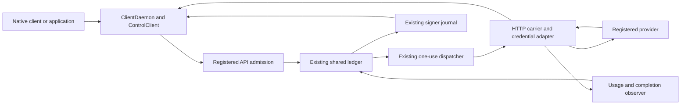

# Universal API gateway design

Status: implemented source contract for the initial finite HTTP scope, 2026-10-12.
The implementation is additive to legacy wire contracts and reuses their financial
state machine. Published packages, funded profiles and deployed capabilities
remain separately versioned; see [current support](../support.md).
The [finite HTTP contract](universal-api-gateway-contract.md) fixes the wire,
pricing and receipt shapes. Start with the [finite HTTP guide](../getting-started/finite-http-api.md)
for source integration. Local synthetic, real-proof/SBF and public provider
acceptance remain distinct verification scopes.

## Objective

An operator should be able to connect an HTTP API by registering its destination,
credential policy, execution limits and price, without changing ZKAPI's payment
code or teaching its transport every field in the provider's request schema.
Consumers should use ordinary clients through clientd or the existing SDK.

The first concrete native clients are Codex to OpenAI Responses and Claude Code
to Anthropic Messages. Neither path requires conversion between API dialects.
The same carrier must handle query parameters, custom end-to-end headers, GET,
POST, PUT, PATCH, DELETE, HEAD and OPTIONS, and JSON, text, form, multipart and
binary representations. Response streaming is part of the carrier.

"Any API" means an extensible payment system with a general transport, not a
claim that one implementation already understands every protocol or billing
model. Ordinary finite HTTP requests can use a fixed price without a custom
payload parser. Usage pricing, asynchronous completion, live uploads, WebSocket
and gRPC require the explicit capabilities below. A missing capability produces
a configuration/admission error, not a rewritten request or a mode fallback.

Generic access uses explicit proxy mode. Existing direct integrations continue
using provider-specific credential issuance, verification, retirement and usage
capture. An ordinary provider key does not establish generic direct support.

### Initial implementation boundary

The initial capability is `finite_http_v1`: bounded complete requests, streamed
finite responses/SSE, fixed-price HTTP completion, and pinned OpenAI Responses
and Anthropic Messages usage meters. Bearer, API-key header, Basic and no-auth
credentials are included. Query/header preservation and opaque representations
are required, not inference-only exceptions. The initial request encoding is
identity; opaque responses preserve declared encodings. Built-in JSON/SSE meters
decode a bounded shadow stream for declared identity/gzip/deflate/br responses,
while forwarding the original encoded bytes.

Large/live uploads, acceptance/completion-priced async jobs, recovery polling or
cancellation, provider-retained private resources, WebSocket and gRPC are
extension designs below. They are **not enabled by version 2 alone**. Registration
must reject these capabilities until their additional wire/state contracts,
installed adapters and acceptance cases exist. Initial recovery uses the existing
finite-operation unknown/fencing path. This keeps the implementation gate finite
without presenting future capabilities as configuration switches.

## Decision and ownership

Separate three responsibilities:

| Component | Owns | Does not own |
|---|---|---|
| HTTP carrier | Registered routing, authentication injection, request/response bytes, backpressure and transport limits | Provider JSON field or tool-type allowlists, prices, balances |
| Metering and execution adapter | Price reservation inputs, resource selection, usage observations, terminal evidence and recovery lookup | A wallet, balance, financial journal, authorization or settlement state machine |
| Existing ZKAPI core | Proofs, capped authorization, durable reservations, operation identity, receipts, settlement and recovery | Interpretation of ordinary API payload fields |



`WalletClient`, `ControlClient`, `ClientDaemon`, the encrypted journal, the single
ledger writer and the independent signer remain authoritative. A transport
module cannot issue a receipt, release a reservation or advance a note itself.
The dispatcher revalidates the saved contract and owns provider credentials and
egress. Admission cannot bypass it with a direct HTTP request.

No change to circuits, proof public inputs, Vault layout, denomination or state
signature algebra is proposed. The existing authorization binds `quote_hash`;
that quote can commit to the new API contract. Off-chain contract, journal,
receipt, verifier and ledger validation changes are required and are versioned.

## Registered contract

Introduce `ApiBinding` version `"2"`, alongside the unchanged version `"1"`
POST-JSON binding. One binding identifies one priced operation. Its canonical
JCS bytes and SHA-256 hash are immutable. The tariff includes the full binding;
its hash is authenticated by the manifest/profile and signed quote, as today.
There is no new tariff signature or signing authority. The signed quote selects
that exact tariff and binding. Discovery uses
the existing catalog and `services`, not a second service registry.

The binding is a closed, versioned control-plane schema with these groups:

| Group | Required meaning |
|---|---|
| Identity | Version, service and operation IDs; explicit proxy mode |
| Transport | Adapter ID, version and installed artifact digest; `http_finite` v1 initially |
| Destination | Fixed HTTPS origin and allowed method/path rules; no caller-selected origin |
| Query policy | Preserve valid query octets by default; optional service-specific constraints and declared operator-injected keys |
| Header policy | End-to-end forwarding policy, reserved fields, identity/credential handling and bounded header sizes |
| Representation | Accepted media/encoding capabilities and finite request/response byte limits; opaque bytes by default |
| Response policy | Allowed response exposure, trailers, redirects and terminal rules |
| Limits | Header, body, decompressed inspection, duration, idle, parser-memory and concurrency limits |
| Meter | Adapter ID/version/artifact digest, price basis, declared units and configuration hash; exact resource/model selection where applicable |
| Completion | What event satisfies the service: response completion, accepted job or completed job |
| Recovery | Lookup/cancellation adapter pins, external execution bounds and unknown-result policy |
| Authentication | Public scheme/policy identity, including fields replaced by the operator; no secret values |

Private operator configuration maps the authentication policy to credential
references. Initial credential adapters cover Bearer, API-key header, Basic and
no upstream authentication. Query-key injection, OAuth refresh, request signing
and mTLS are separate credential capabilities with pinned behavior. Refresh or
signing never causes replay of an uncertain business request. Caller-supplied
provider credentials, user delegation and cookie-based provider sessions require
an explicitly declared authentication contract; they are not inferred from a
forwarded header.

Resource ownership is also a registered policy. Initial services are stateless
or explicitly shared-public-resource services. A path parameter, JSON object ID
or provider key alone does not authorize access to another consumer's stored
object. Private retained resources require a separate ownership/lifecycle
capability that binds handles to the authenticated caller or original operation
before egress, including lookup, deletion and references inside payloads.

Route rules support exact paths and segment templates with bounded parameters.
No unrestricted regular-expression rewrite or origin substitution is needed.
Literal paths may contain valid percent escapes; the route matcher and HTTP
sender must agree on the target. Ambiguous encoded traversal/separators are
rejected rather than decoded differently by different layers. Preserve permitted
escape spelling and query order in the dispatched target. Registration rejects
overlapping native mounts unless a pinned resource selector resolves them
uniquely before authorization. Model selection never selects an arbitrary URL.

Existing inference endpoint enums become compatibility facades over this
executor for new profiles. Legacy routes continue their original contract for
old profiles; installing a new binary cannot reinterpret an accepted operation.

### What is configuration-only

After implementing the carrier and built-in adapters, these additions require
registration/configuration, not payment-core changes:

| API | Required configuration |
|---|---|
| GET lookup with repeated query keys | Origin, route, query policy, authentication, limits and fixed price |
| POST/PUT multipart or binary upload | Route, content limits, credential policy and completion/price rule |
| XML, text, JSON or binary download | Response representation, completion rule and fixed price |
| Codex to OpenAI | Responses mount, OpenAI credential reference, model/resource pins and Responses usage tariff |
| Claude Code to Anthropic | Messages mount, Anthropic credential reference, model/resource pins and Messages usage tariff |

A new usage format requires a metering adapter. A new credential scheme requires
a credential adapter. A new transport requires a transport adapter. These are
trusted, build-pinned operator components, not arbitrary code supplied by an API
caller or downloaded automatically from a public descriptor. None introduces
another financial state machine.

## HTTP preservation rules

The transport must not globally reject unknown JSON properties, custom tools,
provider feature headers or all query strings. Provider bodies are opaque bytes.
An adapter may parse a bounded shadow copy for routing or accounting; it does not
reserialize the transmitted body. A field is rejected only under a named route,
privacy, credential, metering or resource-limit policy, with a stable error.

| Surface | Behavior |
|---|---|
| Target | Separate route matching from the query; retain the exact accepted origin-relative path and query, including duplicate keys, empty values and ordering |
| Method | Preserve a registered method; GET does not imply free, cacheable or safe to replay |
| Request headers | Preserve permitted end-to-end fields and repeated values; reserve local authentication and ZKAPI control fields |
| Body | Preserve bytes, multipart boundary and content type; no JSON-to-JSON normalization |
| Response | Preserve provider status, body bytes, content type, allowed end-to-end headers and declared trailers |
| Streaming | Relay data promptly; parse a separate bounded observation stream without modifying provider events |
| Errors | Distinguish a provider response from a ZKAPI admission/transport error; an upstream 4xx/5xx is not automatically rewritten as a synthetic success |

Hop-by-hop fields, including fields named by `Connection`, do not cross hops.
Reject ambiguous framing, control characters and conflicting singleton headers;
rebuild Host/authority and framing for the registered destination. Local
Authorization, proxy tokens, management credentials and forwarding metadata are
never provider credentials. Do not copy inbound `Content-Length` or transfer
framing blindly. HTTP header-name casing and hop framing may change; semantic
header values and content bytes must be preserved.

Provider feature namespaces such as `anthropic-*` are open for transport, subject
to the reserved credential fields and resource bounds. Do not enumerate every
beta string in the common carrier. For a usage-priced service, the adapter still
must establish that requested features fit the authenticated price/reservation
policy. An unpriced hosted tool or new billing category produces a metering
error before egress; a new nonfinancial field does not.

An unknown field is not automatically nonfinancial. The adapter needs a pinned
provider contract establishing its cost bound, a reservation covering every
enabled charge category, or an explicit operator-exposure policy in the selected
tariff. Otherwise it rejects the request before egress. This decision belongs to
the service's meter policy, not a global HTTP field allowlist. Fixed-price opaque
services can accept new payload fields under their declared exposure policy.

Privacy policy is explicit in the binding. A permissive provider-native service
can forward `metadata.user_id` or cache identifiers; its profile discloses that
policy. A stricter service may reject them. Do not silently erase identifiers,
drop beta headers or advertise anonymity while forwarding them. Upstream cookies,
provider credential headers and browser security headers require the declared
response/authentication policy; provider CORS does not grant access to clientd.
Clientd's peer, Host, Origin, Sec-Fetch-Site and token boundaries remain enforced.

No automatic redirect, HTTP retry, speculative request or caching is enabled.
The SDK's outer execution request uses manual/no-follow redirect handling.
Returning a provider redirect is permitted only to a consumer with an explicit
no-follow contract; an unmodified native client may otherwise follow `Location`
outside the gateway. A native profile without verified no-follow behavior rejects
redirect exposure with a stable gateway error. Following a redirect through ZKAPI
requires a separate registered operation and admission, destination and identity
checks. The proxy never follows it on the caller's behalf. DNS resolution
and egress retain the existing public-address restrictions and destination pins.

Content encoding is explicit. The relay preserves the selected representation;
an observation decoder has its own decoded-size, ratio and memory limits. A
metering adapter rejects unsupported request encodings or negotiations before
dispatch. An unexpected upstream response encoding is a post-dispatch failure:
bound/terminate observation, preserve uncertainty and never retry the request.
Finite multipart/binary requests use bounded buffers initially. Larger uploads
need a declared upload capability rather than silently raising every limit.

## SDK, native mounts and execution wire

Extend the existing `requestApi()` with a version-discriminated invocation. Keep
the current JSON overload unchanged. The new shape is conceptually:

```ts
type HttpInvocation = {
  version: "2";
  operationId: string;          // Saved UUIDv4, never reused to execute again.
  service: string;
  operation: string;
  bindingHash: string;          // Must match the loaded authenticated service.
  method: string;
  target: string;               // Origin-relative path and query, never a URL.
  headers: readonly [string, Uint8Array][]; // ASCII names; field-value octets.
  body: Uint8Array;             // All invocation fields are snapshotted before awaiting.
};
```

The SDK resolves origin, credentials and price from the registered contract.
It returns a lossless v2 result, not just a Fetch `Response`:

```ts
type HttpResult = {
  operationId: string;
  statusPath: string;           // Validated control-relative recovery path.
  status: number;
  headers: readonly [string, Uint8Array][];
  body: ReadableStream<Uint8Array>;
  trailers: Promise<readonly [string, Uint8Array][]>;
  completed: Promise<void>;    // END plus clean outer EOF; rejects on carrier failure.
};
```

HTTP success is separate from signed settlement. `completed` does not assert
payment finality; status/receipts use existing authenticated recovery. Applications
must consume or cancel a response; cancellation rejects `completed`. Trailers
resolve to an empty list only on a successful carrier without trailers. All
metadata and body chunks are detached from mutable caller/transport buffers.
The Go/Node/SDK bridge carries v2 frames or equivalent ordered octet pairs all
the way through; it must not pass through lossy `Headers` or plain header maps.
An optional Fetch conversion rejects unsupported status/header/trailer semantics
explicitly. Browser restrictions on headers, streaming and
trailers are exposed as transport capabilities; unsupported browser operations
fail before authorization rather than changing the intended request.

Native mounts let unmodified clients use their own API paths. An authenticated
local mount is bound to one selected service/profile, with disjoint operation
routes. A single profile may expose Responses and Messages through explicit
mounts; ambiguous model/service routing is rejected. The same ClientDaemon,
note and journal remain responsible for financial serialization. Switching to
an operation with a different quote scope settles the previous session first.
Do not claim cross-operation concurrent use of one note.

A mount has an authenticated literal prefix (empty or beginning with `/`, no
trailing `/`, escapes or query). Strip that prefix on a segment boundary exactly
once and keep the remaining raw origin-relative target, including its query.
An empty remaining pathname becomes `/`. Match and HMAC-bind this upstream
target; never URL-join, decode/re-encode or rewrite it. Reserve `/admin`, `/zkapi`
and their descendants, `/v1/models`, and all existing discovery/management routes
before mount selection. Reject collisions at registration. A new profile may
explicitly replace a legacy inference facade with one native mount, but cannot
share that route with the facade or change an old profile's routing.

For new gateway calls, use `POST
/zkapi/v2/execute/{service}/{operation}` envelope between SDK and proxy. The outer
method is a control transport; the provider method is preserved inside it. This
avoids putting provider query contents in the proxy's access-log URL and avoids
collisions between provider credentials and ZKAPI authentication.

For finite HTTP requests the envelope contains a four-byte big-endian metadata
length, at most 64 KiB of canonical UTF-8 JSON metadata, and exactly the declared
body length of raw bytes. Metadata is a closed object containing version `"2"`,
binding hash, method, target, ordered header pairs and decimal-string body
length. Wire header pairs contain lowercase ASCII names and canonical padded
Base64 values encoding the accepted HTTP field-value octets. SDK convenience
helpers may accept ASCII strings; they must not silently UTF-8-reencode opaque
HTTP header values. The same encoding applies to response headers and trailers.
Outer Bearer authentication and UUIDv4 `Idempotency-Key` retain their
existing roles. All lengths also obey the lower authenticated service limits.
Invalid or incomplete envelopes cannot dispatch. Version 2 finite bodies are
bounded below the existing framing helper's 32-bit part-length limit.

The remote response is framed separately from provider data: an initial
`HEADERS` record carries the original status and end-to-end header pairs,
`DATA` records carry raw content, optional `TRAILERS` carries trailer pairs, and
`END` closes the carrier. Each record has a one-byte tag and four-byte big-endian
length; tags 1 through 5 respectively mean HEADERS, DATA, TRAILERS, END and
GATEWAY_ERROR. Metadata records use bounded canonical JSON, DATA is opaque and
END is empty. Exactly one HEADERS precedes DATA; TRAILERS is at most once and
last before END. HEADERS contains the final status in 200 through 599;
informational 1xx responses are consumed at the HTTP hop and are not represented
as additional HEADERS. Status 101 requires a separate upgrade capability. HEAD,
204, 205 and 304 responses contain no DATA. Framing lengths are rebuilt at each hop;
Content-Length is retained only as representation metadata for HEAD/304, never
as their expected body length; strip it from other downstream responses.
Empty DATA records are disallowed. GATEWAY_ERROR is terminal
and contains only a bounded error code and operation/status identity.

Outer HTTP failures before response framing are ZKAPI errors. Inside a framed
response, any valid provider status is carried in HEADERS. Clientd unwraps the
frames into the native provider response. A failure after native headers were
sent closes that stream and exposes operation status separately; it never
injects JSON into an SSE or binary body. Missing END is transport uncertainty,
not successful completion. END itself is not evidence of a billable provider
completion. Native and SDK facades share this framing implementation.

Do not forward provider `Content-Length` on body-bearing native responses.
Regenerate chunked HTTP/1.1 or HTTP/2 framing and emit the downstream final chunk
or END_STREAM only after END and clean outer EOF. Otherwise a lost END after
the advertised body length would look successful to the native client. Hold
HEAD/204/205/304 native headers until that carrier completion, because those
responses cannot signal a later failure through body truncation. A failure
before native headers uses a gateway error; a later failure aborts the hop.
This guarantees carrier completion signaling, not signed payment completion.

The dispatcher continues usage observation after a consumer disconnect, with
bounded buffers and deadlines. Slow consumers cannot suppress provider metering.
Stopping relay delivery and stopping remote execution are distinct events.

## Operation identity and data retention

Version 1 operation HMACs remain byte-for-byte unchanged. Version 2 uses a new
domain and commits to every accepted semantic request input:

```text
key = SHA256(ASCII("zkapi-proxy-body-v2") || proxy_secret_raw32)
operation_hmac = HMAC-SHA256(key, frame("solana-zkapi-operation-v2", [
  deployment_id, pool, authorization_id, operation_id,
  binding_hash, tariff_hash, method_ascii, raw_target_ascii,
  JCS(semantic_header_pairs), raw_body_bytes
]))
```

The exact framing and part encodings are fixed in the
[finite contract](universal-api-gateway-contract.md#operation-hmac-encodings);
`authorization_id` is the existing authorization `request_id`, not a new ID.
Lowercase header names, remove hop/control fields and
trim only HTTP field-line boundary whitespace before binding. Preserve duplicate
value order and never combine non-list fields with commas. Canonicalize once at
admission and independently reproduce it at dispatch. Sort distinct header names
in ASCII order; retain the received order of values within each same-name group.
Represent those values as the canonical Base64 pairs defined above before JCS.
Native parsers must preserve repeated values before any lossy Fetch/Headers or
map conversion. The exact target retains
query ordering and percent-escape spelling; do not parse and reconstruct it with
a generic URL search-parameter serializer.

The binding hash commits to the credential injection policy, nonsecret static
fields and adapter versions. No upstream credential value enters this HMAC or
financial record. Operator-injected secret query/header fields are excluded from
caller control and attached only by the dispatcher. Request-signing adapters
must sign the final provider request after this injection. Request transforms,
if later supported, need their own pinned contract and must bind both input and
effective nonsecret request; no transform is implicit in version 2.

The same operation ID with changed method, query, semantic header, body or
contract conflicts. Repeating the identical ID returns existing status; it never
dispatches again. An upstream idempotency key may be deterministically derived
from this identity under an explicit adapter policy, but is defense in depth,
not permission to retry an uncertain call. Required native retry settings are
part of client compatibility: a caller retry without its original identity cannot
be safely deduplicated by comparing prompts or bodies.

Persist prepared data only in the existing encrypted client journal. New entries
carry the invocation version and envelope. At the existing atomic send transition,
redact body, raw query and semantic header values; retain identity, contract pins,
phase and keyed evidence needed for recovery. Never persist plaintext URL/query
fingerprints or provider content in the server ledger, logs or access traces.
Secret-bearing job handles needed for recovery require a dedicated encrypted
field under operator recovery custody and must not appear in public receipts.

## Metering contract

Adapters expose the following conceptual interface inside the existing executor:

```text
prepare(binding, tariff, request_view) -> resource, reservation, completion_rule
observe(response_event) -> bounded usage/evidence observations
finish(transport_outcome) -> measured | not_dispatched | pending | unknown
inspect(saved_execution_reference) -> additional evidence, never redispatch
```

The ledger validates the selected resource, contract, reservation and normalized
units independently. The signer and SDK verifiers recompute charges from the
frozen tariff and receipts; they do not blindly trust an adapter's charged amount.
Adapters cannot perform arbitrary network work in `prepare` or `observe`.
Recovery lookup uses the registered dispatcher/egress path and its own bounds.

`pending` carries a bounded saved execution reference and the selected observation
deadline. It represents a known accepted execution awaiting its completion rule,
not missing usage from a terminated execution. Keep the existing operation
nonterminal with subordinate execution metadata; do not introduce another balance
or settlement state machine. The current recovery loop's immediate quiesced-owner
waiver must not apply to such a pending job before its declared resolution point.

There are two initial price bases:

| Basis | Reservation | Charge evidence |
|---|---|---|
| Fixed operation price | Full advertised price before sending | The contract's observable completion event; payload semantics need not be inspected |
| Usage rates | Conservative maximum for the selected resource/features | Declared usage units from a complete provider observation or authenticated lookup |

Fixed price can mean a completed HTTP response, an accepted asynchronous job or
a completed job. These are different contracts. HTTP 2xx alone does not prove
completion; HEAD/204 may have a complete empty body, while 202 may only mean
acceptance. The existing `http_2xx_json` rule remains one selectable legacy
policy, not a universal definition. The operator bears upstream costs above a
fixed customer price under a declared exposure policy; transport need not know
the provider's private cost model to sell a fixed-price operation.

Receipt `operator_loss_nano_usdc` records the tariff-observed amount above the
capped customer charge. It does not measure an unknown provider invoice. For a
fixed-price service, upstream costs exceeding the advertised fee are separate
operator business exposure; record any such observation without changing the
customer ledger or signed charge.

For usage pricing, the adapter declares a finite sorted unit set with integer
counts, exact rational nano-USDC rates and a bounded maximum count per unit.
Units can include requests, bytes, milliseconds, tokens or job units. No global
token-only enum applies to the new receipt version. The pinned meter defines
unit meanings; the rounding formula is fixed and cannot be configured by a
tariff. The tariff is capped to a small configured unit count (initial
maximum 32). Reject duplicate units, unknown units, negative values and overflow.
Keep canonical integer counts and rate numerator/denominator inputs within the
existing signed-64-bit bounds, and aggregates within `NUMERIC(38,0)`. A valid
observation can exceed its reservation's predicted maximum: retain that evidence,
cap the customer charge and account for the excess. A parser overflow remains
unknown evidence, not a wrapped count or a zero charge.
Keep current exact rate-sum rounding to integer nano-USDC and session rounding
to micro-USDC; never use floating-point money or independently round stream chunks.

For each operation, customer charge cannot exceed its durable reservation. The
sum of charged amounts and outstanding reservations cannot exceed the session
cap. Provider costs beyond those amounts remain operator losses. A quote cannot
silently increase a cap to make an oversized request fit. If a usage reservation
cannot be established, reject before egress or use a separately selected,
explicit fixed-price service; never silently change pricing modes.

The OpenAI and Anthropic adapters read a shadow JSON/SSE view only for resource,
feature costs and normalized usage. New ordinary payload fields, custom tool
definitions and provider event types pass through the carrier. Missing optional
output limits can reserve the pinned provider maximum; a request exceeding a
service limit is explicitly rejected, not silently truncated. Cache categories
and reasoning/thinking output are normalized without double counting. Hosted
tools, new service tiers and beta features affecting charges need a priced bound,
the explicit usage-tariff `operator_absorbs_unpriced` policy, or the fixed-price
operator-exposure contract. None enables retained private resources or async work
without their separate capabilities.

Unknown usage is never zero usage. Unknown carrier events are relayed; if they
prevent a trustworthy terminal accounting observation, the operation is unknown.
Do not settle on a text-done event while final usage or provider termination is
still outstanding under the selected completion rule. Acceptance-priced jobs may
settle before remote computation completes. A provider error may itself incur cost; billing follows the
selected adapter, not a global assumption that every non-2xx is free.

## Streaming, asynchronous work and other protocols

Only the finite HTTP row is in the initial implementation gate. The remaining
rows specify extension constraints, not completed executable contracts. Their
registration stays disabled as described in the initial implementation boundary.

All variants remain subordinate to the existing operation/reservation and
session states. Additional execution records describe provider work and attempts;
they do not hold a second balance or issue an independent successor state.

| Capability | Execution and reservation | Terminal/recovery contract |
|---|---|---|
| Finite HTTP + streamed download/SSE | Bind the complete request and reserve before one dispatch; stream response without buffering it all | Provider completion and final meter observation, or existing unknown path |
| Large finite upload | Client encrypted spool and known length; bounded server validation before dispatch, or the explicitly selected upload-stream capability | Partial send remains uncertain; no resend from the spool |
| Live upload | Bind route/headers/limits initially; bind directional chunk sequence and rolling keyed transcript before forwarding each bounded chunk | Deadline/byte bound and provider completion evidence; no automatic stream resume |
| Async job, priced on acceptance | Reserve full price; one job creation; settle only on the declared authenticated acceptance observation | Later job state is service metadata, not an additional charge on the settled note |
| Async job, priced on completion/usage | Reserve the complete declared maximum before creation; keep original operation pending while observing the saved job | Lookup by saved/caller-chosen reference; final usage or explicit unknown-loss resolution |
| WebSocket or bidirectional gRPC | One bounded channel operation; reserve its entire budget before handshake, with duration/byte/message limits | Explicit close/final usage or uncertainty; do not reconnect/replay or renew the same financial operation |

The framed finite HTTP carrier does not implement duplex transport. A separate
versioned transport capability must define handshake/subprotocol negotiation,
directional frame sequencing, initial request commitment and final keyed
transcript, bounded metering lag and close semantics. Its initial commitment
cannot pretend to include future unknown payload bytes. Per-direction sequence
numbers and cumulative counts are enforced before forwarding. Data frame records
do not constitute independently spendable authorizations. Reserve the full
channel maximum; incremental top-ups and cross-session live channels are outside
this design. Close the channel before selecting another authorization.

gRPC transport must preserve HTTP/2 metadata, message framing, compression policy
and final trailers, including gRPC status. WebSocket transport must preserve its
negotiated protocol and data/control-frame semantics. Neither is advertised by
enabling an HTTP URL in a configuration file. Their registration needs the
matching installed transport and metering capabilities.

Distinguish three facts during recovery:

1. The local dispatcher cannot send anything further.
2. The remote job or computation has actually stopped.
3. The billable quantity is final under the provider's accounting contract.

A local timeout, EOF or fenced process proves neither remote cancellation nor
final usage. Persist bounded provider execution references before treating them
as recoverable. If the creation response is lost, lookup requires a reference
known before sending or provider-side lookup by the original idempotency key.
If neither exists, mark unknown; never submit the job again to discover its ID.

Recovery polling may repeat only documented non-executing lookups, with a fixed
deadline/count and an explicit operator-funded polling budget. A GET method alone
does not establish this property. Cancellation is a distinct, durably claimed
provider control action; a lost acknowledgement remains uncertain and does not
authorize repeated cancellation unless its specific contract provides recovery.
Neither polling nor cancellation may start another billable job.

Add scoped durable recovery-control claims tied to the original authorization,
operation, execution reference, adapter version and action identity. Business
dispatch remains one-shot. Lookup claims may operate during drain/reconciliation;
cleanup-only claims may survive settlement under the saved contract. They cannot
reopen admission, change a reservation, recreate a job or add customer charges.
Each mutating cancellation attempt keeps its original identity after uncertainty.
Polling and cancellation costs both come from the declared operator-funded
recovery budget. Existing dispatch-attempt ownership/fencing rules apply, with
separate claim kinds and uniqueness rules for business dispatch and recovery work.

Unknown customer charges follow the existing drain, finished/fenced-attempt and
operator-loss rules. An unknown waiver does not assert that a remote job stopped.
An async service must separately bound or explicitly accept remote provider
exposure and retain cleanup ownership after customer settlement. No late evidence
changes an already signed charge. Jobs must fit declared execution and note-expiry
policy; indefinitely running jobs cannot silently hold or renew a customer's note.

Separate admission, execution, observation/reconciliation and cleanup deadlines.
Current source limits include a 1–300 second admission TTL, a 600-second generic
execution maximum, a 610-second dispatcher IPC budget and a 900-second proxy
reconciliation target. Preserve those values for legacy operations. New profiles
must pin coordinated values across clientd, SDK, gateway, dispatcher, ledger and
recovery scheduler; enabling a longer job cannot merely increase an HTTP timeout.
Admission expiry stops new work without asserting that previously admitted work
has stopped. Observation and cleanup continue only within their saved contract.
The Pool/circuit cap remains immutable; a larger advertised limit cannot raise it.

## Codex and Claude Code profiles

| Local native route | Upstream | Required adapter behavior |
|---|---|---|
| `POST /v1/responses` | OpenAI `/v1/responses` | Preserve Responses fields, custom tools and their outputs; observe final usage while relaying SSE |
| `POST /v1/messages?beta=true` | Anthropic same path/query | Match on pathname, preserve query and beta/version headers, metadata and Messages content; observe final usage |
| `POST /v1/messages/count_tokens` (deferred in new gateway profiles) | Anthropic same route | Requires a separate bounded operator-funded contract and explicit quote scope; disabled initially |

Codex's `apply_patch` tool definition is provider payload, not a tool executed by
the ZKAPI server. Client-executed tools continue to execute in the client. A model
turn, local tool execution and the next model turn are distinct API operations;
the latter receives a new operation ID only because it is new work, not a retry.

Use native HTTP/SSE transport first and disable automatic request/stream retries
in these client profiles. Set Codex's provider base URL and Claude Code's
`ANTHROPIC_BASE_URL` to the selected local mounts, and provide only the local API
token. The proxy owns the ordinary OpenAI/Anthropic credentials. Authentication,
feature/privacy policy, model limits and tariffs must match the registered
profile. Provider-native fields such as `store` are governed by the explicit
profile; any newly allowed retained provider resource needs a lifecycle contract.

The initial Responses profile requires caller-supplied `store:false`; omitted
`store` is not accepted because the provider defaults it to true. `background`
must be absent or false. Reject non-null `previous_response_id`, `conversation`,
stored prompt/file references and other retained private-resource handles before
authorization. Inline tool outputs and stateless reasoning continuation remain
valid payloads. Do not reuse the legacy adapter's insertion of `store:false` or
`background:false`: v2 transmits the original bytes. See the
[Responses request reference](https://developers.openai.com/api/reference/resources/responses/methods/create).

Pin a client binary/version, isolated configuration and fixture matrix for every
native profile. Start from the existing [Codex probe](../../scripts/run_codex_clientd_acceptance.ts)
(CLI 0.145.0, HTTP Responses, `supports_websockets=false`,
`request_max_retries=0`, `stream_max_retries=0`, request compression disabled) and
[Claude Code probe](../../scripts/run_claude_code_clientd_acceptance.py)
(2.1.220, `CLAUDE_CODE_MAX_RETRIES=0`,
`CLAUDE_CODE_DISABLE_NONSTREAMING_FALLBACK=1`). Those are fixture pins, not a claim
about the latest client or successful gateway support. Codex's base includes
`/v1`; Claude's base does not, since it appends `/v1/messages` itself.

Retry counters alone are insufficient: Claude also documents
[capability-specific retries](https://code.claude.com/docs/en/llm-gateway-protocol#automatic-retry-and-error-forwarding).
Test 400/422 capability rejection, 429/503, lost headers, stream truncation, idle
timeout, cancellation and fallback through the complete gateway. A modified
automatic retry is still a replay of uncertain work even if its body differs.
Native requests without a caller UUID may receive a generated UUID only for a
new call; after uncertainty the existing durable recovery hold rejects subsequent
calls before ID allocation/authorization until explicit recovery. Never use body
equality as retry detection. A client/profile that still retries after an error
that may have dispatched is incompatible until its retry behavior is controlled.

Optional `count_tokens` needs a separate operator-funded capability with local
API-token authentication, its own rate/concurrency/size budget, stable identity
and the existing authorization/dispatch ownership rules. Zero customer charge
does not remove those controls. It is not part of the initial finite binding's
meter set; reject the route before authorization/egress when unregistered. Its
later contract must define how it shares or changes quote scope before it can be
enabled. Preserve the legacy endpoint's current semantics for old profiles.

The `beta=true` query is not itself a cost category or a ZK concern. Do not solve
compatibility by stripping it or all beta headers. Likewise, selecting an OpenAI
model does not make a Chat Completions route into Responses. Existing direct
profiles do not automatically become proxy profiles.

## Versioning, compatibility and implementation boundaries

Version assignments for the initial contract (legacy bytes remain frozen):

| Surface | New contract | Compatibility rule |
|---|---|---|
| API binding | `version:"2"` | Retain the exact POST JSON version 1 parser/bytes |
| Tariff | `version:"3"` with binding v2 and declared units | Versions 1/2 keep original pricing and hashes |
| Operation envelope/HMAC | Version 2 | No reinterpretation or recomputation of version 1 identities |
| Receipt | `version:"3"` | Add binding/operation commitment, meter identity, declared units and completion evidence; keep old versions intact |
| Public profile | Schema 3, explicit gateway capabilities | Schemas 1/2 and exact SDK-version membership remain readable as originally specified |
| Client journal | NoteJournal schema 3, discriminated invocation/execution metadata | EncryptedRecord envelope stays schema 1; old entries retain exact authorization/receipt bytes and custody bindings |
| Ledger | Additive migration and versioned record validation | Retain old operations, frozen tariffs, claims, receipts and signer targets |

Receipt v3 still binds deployment, Pool, authorization, operation ID and tariff,
and retains reservation, observed/charged/operator-loss quantities and signature.
Measured usage contains every tariff unit exactly once, including explicit zero
counts. Unknown/not-dispatched evidence carries no invented
measured counts. Completion/lookup evidence is bounded and prompt-free. Native
and WASM verification, signer validation and SDK recomputation must agree before
any profile advertises v3 support.

Keep the authorization version and proof binding unchanged; strict quote parsers
must explicitly accept binding v2. Implement the new receipt verifier in the
existing verification path. Do not label off-chain format changes as a circuit
change, or claim that they require no compatibility work.

| Existing source | Responsibility |
|---|---|
| [Go frontend](../../apps/clientd/internal/daemon/server.go), [runtime](../../apps/clientd/runtime.ts) and [network bridge](../../packages/sdk/src/clientd-network.ts) | Native mounts, query-aware routing, lossless header/trailer types, raw egress and bounded request/response framing |
| [ClientDaemon](../../packages/sdk/src/clientd-bridge.ts) | One shared executor for native mounts and SDK invocations; unchanged note serialization/recovery ownership |
| [ControlClient](../../packages/sdk/src/control.ts) and [client facade](../../packages/sdk/src/client.ts) | Versioned invocation, journal, request binding, streaming and receipt verification |
| [Public profiles](../../packages/sdk/src/public-profile.ts) and [registration](../../scripts/zkapi_api.ts) | Signed capability loading, offline validation and configuration generation |
| [Control inference](../../services/control/src/inference.rs), [generic adapter](../../services/control/src/generic.rs) and [proxy adapters](../../services/control/src/proxy/mod.rs) | Common admission/HTTP carrier, separate meter implementations and legacy facades |
| [Egress](../../services/control/src/egress.rs) | Versioned dispatcher envelope, independent binding/reservation checks and credential isolation |
| [Provider runtime](../../services/control/src/provider_runtime.rs) | Pending execution observation, versioned deadlines and scoped recovery/cleanup claims under the original operation |
| [Wire](../../services/control/src/wire.rs), [quotes](../../services/control/src/quote.rs), [receipts](../../services/control/src/receipts.rs) and [ledger](../../services/control/src/ledger.rs) | Versioned identity/units, exact reservation validation and existing single settlement lifecycle |
| [OpenAPI](../contracts/openapi.json), [ledger schema](../contracts/ledger.sql) and native/WASM verifier contracts | Corresponding executable schemas, migrations and reproducible binding/accounting vectors |

New registrations use a new immutable profile/runtime namespace and authenticated
build inputs. No in-place change to funded installations or published artifacts
is implied. Keep original recovery runtimes and records. Old accepted operations
must remain recoverable using their pinned semantics; a server upgrade cannot
discard the code or credentials needed to retire them. Downgrading a writer that
cannot understand newly accepted contracts is not a valid recovery procedure.

Registration validation remains offline; public preflight retains its existing
read-only authenticated HTTP/RPC checks. Neither
creates notes, calls providers nor funds or deploys services. Releases and public
deployment changes require their own runtime-input comparison and authorization.

## Required verification

These are contract acceptance conditions, not records of completed tests.

| Area | Required evidence |
|---|---|
| HTTP identity | Changed method, query order/value, duplicate query key, header value/order, body byte or binding conflicts under the same operation ID; exact original request is dispatched once |
| Routing/authentication | Fixed destinations, encoded-path ambiguity, reserved credentials, duplicate/smuggled headers, redirect refusal and no direct fallback |
| Representations | GET query, empty HEAD/204/205/304, XML, JSON with unknown fields, binary and multipart preserve bytes; repeated non-list headers, encoding limits and trailers survive every bridge |
| Native agents | Pinned isolated Codex/Claude clients through actual clientd/SDK/dispatcher/ledger complete text, tools and subsequent turns; capability errors, 429/503, truncation and fallback cause no uncertain replay |
| Streaming | SSE pings, unknown events, final usage, truncation after exactly Content-Length bytes, lost END, late errors, cancellation and slow consumers; no false completion or suppressed metering |
| Metering | Exact mixed units/cache/reasoning, boundary reservations, concurrency, overflow, output-limit absence and new cost-bearing features |
| Disabled extensions | Initial registration rejects async/live/duplex/private retained-resource capabilities, unsupported encodings and credential adapters before custody or egress |
| Future async/duplex gate | Separately specified lost creation/close responses, bounded execution, lookup/cancel claims, remote work surviving local fencing, capped channels and no automatic reconnect |
| Recovery | Crash before/after reservation, dispatch claim and response; original IDs, finished/fenced owners, unknown waiver and unchanged late receipts |
| Compatibility | Legacy quote/HMAC/receipt golden vectors, schema 1/2 journals, old recovery paths and explicit rejection by old runtimes of new contracts |
| Financial lifecycle | Real local proofs, signatures, shared ledger and Vault SBF deposit/use/settle/withdraw, including interrupted operations |

Keep synthetic HTTP/client compatibility evidence separate from real proof/SBF
execution, any separately authorized live provider/Devnet observation, and CI.
A paid live request is not a prerequisite for reviewing this design or running
local fixtures. Full provider/browser coverage and production availability are
not implied by a new carrier.

## Sources and related contracts

- [API, proxy and settlement](api-proxy.md), [operations](operations.md),
  [general API onboarding](general-api-onboarding.md) and
  [API integration](../getting-started/api-integration.md).
- [HTTP semantics, RFC 9110](https://www.rfc-editor.org/rfc/rfc9110.html) and
  [HTTP/1.1 framing, RFC 9112](https://www.rfc-editor.org/rfc/rfc9112.html).
- [WebSocket protocol, RFC 6455](https://www.rfc-editor.org/rfc/rfc6455.html).
- [OpenAI Responses custom tools](https://developers.openai.com/api/docs/guides/function-calling#custom-tools).
- [Claude Code gateway compatibility](https://code.claude.com/docs/en/llm-gateway-protocol).

Provider documentation informs the native adapters; it does not redefine
ZKAPI's financial trust model. Proofs establish payment authorization, while
proxy usage and API results retain the existing operator/provider trust boundary.
